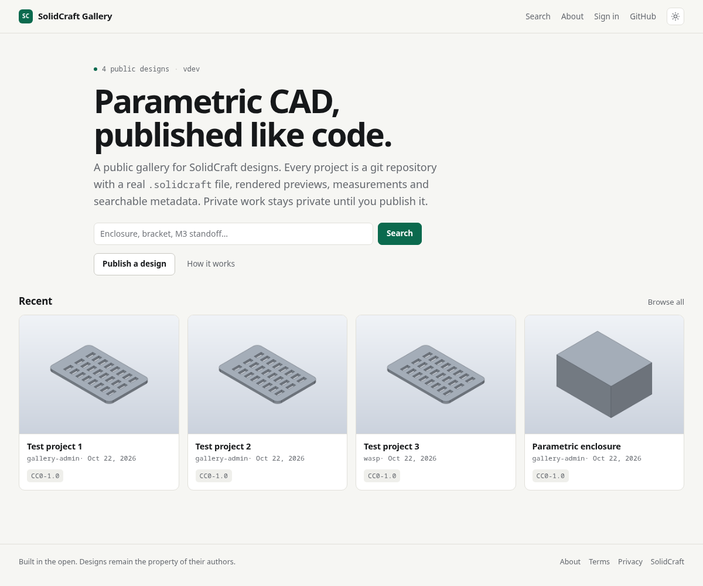
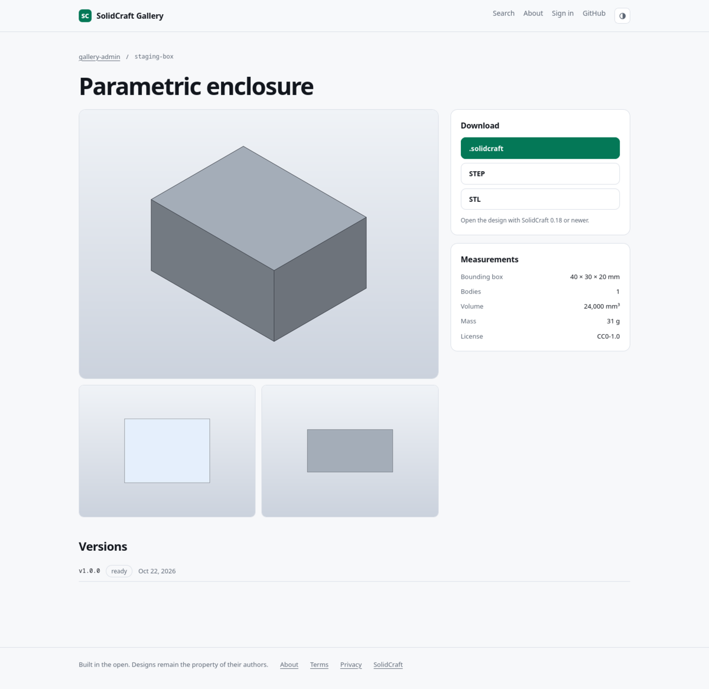
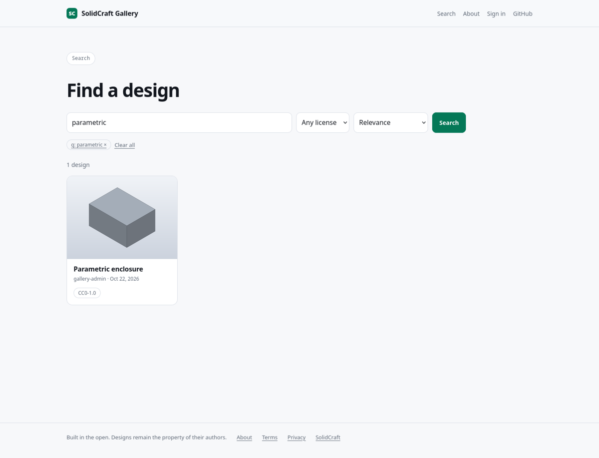
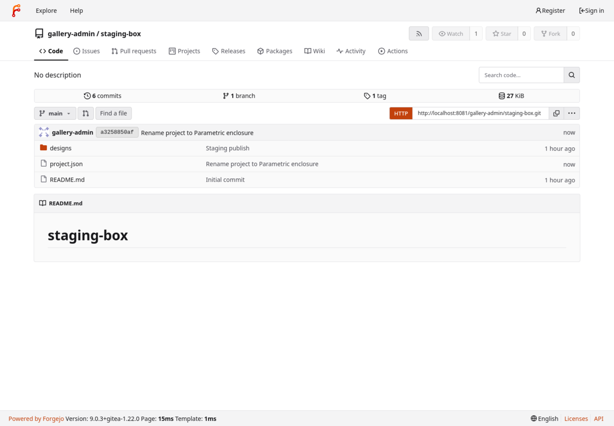

# SolidCraft Gallery

**Working name:** SolidCraft Gallery · **Status:** working M1 + local staging

A public, git-backed gallery for [SolidCraft](https://github.com/tangency-labs/solidcraft) designs:
thumbnails and searchable project pages for the public, a private workspace for signed-in users,
and git repositories as the source of truth — either hosted by the service or brought by the user.

This repository contains both the working implementation and the plan/specifications it was built
from. [STATUS.md](STATUS.md) is the current source of truth for what runs.

> **Implementation status (22 Oct 2026):** M0 is complete; the M1 slice, public gallery and OAuth
> work — Forgejo/GitHub sign-in with invite-gated beta, local/Forgejo/GitHub projects, publish/sync/webhooks, nsjail-sandboxed
> `solidcraft-cli` rendering, project pages, search, sitemap, media, downloads and visibility.
> See [STATUS.md](STATUS.md).

## Screenshots

Taken from the local staging stack: real Forgejo, real `solidcraft-cli`, nsjail worker.

| Public gallery | Project page |
|---|---|
|  |  |
| **Search** | **Git-backed source in Forgejo** |
|  |  |

Despite the folder name, this is **not a SolidCraft plugin**. SolidCraft's plugin boundary is an
in-document command executor with no storage, accounts, background sync or UI; a gallery needs all
four. The rationale is recorded in [docs/00 — Decisions](docs/00-decisions.md).

---

## The product in one page

| Surface | What it does |
|---|---|
| **Public** (anonymous) | Browse, search, tag, view a design with rendered images and measurements, read its README, download `.solidcraft` / STEP / STL, open the source repository, open the design in SolidCraft. |
| **Signed in** | Dashboard with your projects and connected repositories, create or import a project, publish a version, choose public / unlisted / private, manage tags and metadata, API tokens, account settings. |
| **Admin** | Reports and takedowns, featured projects, quarantine, user and quota administration, audit log. |

Every project is a git repository containing one or more `.solidcraft` files exactly as the app
saves them. The site indexes the repository and renders previews; it does not own a second copy of
the design. The same project works whether the repository lives on the service's Forgejo instance
or on GitHub, GitLab, Gitea, or Codeberg.

**The central bet:** a few-megabyte `.solidcraft` container is a good git object when the app's
disposable model cache is stripped. That gives direct format support, readable history, and no
custom storage layer. See [docs/03-repo-format.md](docs/03-repo-format.md).

---

## Fixed decisions

| # | Decision | Why |
|---|---|---|
| D1 | Commit `.solidcraft` as-is (ZIP container) | Direct support; no conversion format; the app opens exactly what the site serves |
| D2 | Strip `cache/*` before committing; 25 MB per-file cap; no LFS in MVP | The model cache is the only large, churning payload; LFS is unnecessary at this size |
| D3 | Forgejo for hosted git | Users, orgs, OAuth2, webhooks, repo browsing and quotas without writing a git server |
| D4 | External repositories are read-only for the site | No pushing into someone's GitHub; the user pushes, the site indexes |
| D5 | SvelteKit + TypeScript, PostgreSQL, Postgres-backed job queue | Small operational surface; SSR for public pages and SEO |
| D6 | One PostgreSQL database, one artifact volume, one Forgejo instance | Fits a single VPS for the first year |
| D7 | CPU rendering (`solidcraft-cli snapshot`) | No GPU host; renders run asynchronously |
| D8 | No live co-editing and no merge | SolidCraft has no document merge; publishing is commit-based and conflicts are rejected |
| D9 | Invite-only beta, public read | Moderation and abuse cost are the main non-technical risk |
| D10 | Public projects require an SPDX license | Downloadable CAD without a license is a legal and community problem |

Full rationale and rejected alternatives: [docs/00-decisions.md](docs/00-decisions.md).

---

## System at a glance

```text
                        ┌──────────────────────────────────────────────┐
  anonymous / user ────►│ Caddy ──► web (SvelteKit SSR, sessions)      │
                        │             │                                │
                        │             ├── PostgreSQL                   │
                        │             │     metadata · FTS · jobs     │
                        │             ├── artifacts volume / S3        │
                        │             │     thumbnails · STEP/STL      │
                        │             └── Forgejo (hosted git)         │
                        │                   OAuth2 · webhooks · repos  │
                        │                                              │
                        │           worker (render + index)            │
                        │             └── solidcraft-cli (sandboxed)   │
                        └──────────────────────────────────────────────┘
   GitHub / GitLab / Gitea / Codeberg ── webhook or poll ──► worker
```

A push (or a tag) produces a commit. A webhook enqueues a sync; the worker fetches the design at
that commit, strips nothing (it indexes what is committed), renders previews and measurements in a
sandbox, writes artifacts, and updates the search index. The public page appears when the version
is `ready`.

---

## Deployment

The single-host stack is deployed with Ansible and Docker Compose. Caddy publishes the gallery on
`8080` and Forgejo on `8081`; `solidcraft.drun.net` and `forgejo.drun.net` are configured in `.env`,
and HTTPS is a one-line cutover when DNS is ready.

```sh
cp .env.example .env && chmod 600 .env
uv venv .venv && uv pip install -r infra/ansible/requirements.txt
./scripts/deploy.sh --check
./scripts/deploy.sh
```

See [16 — Deployment](docs/16-deployment.md) for prerequisites, secrets, the HTTPS cutover,
Forgejo bootstrap, backups and rollback.

---

## Plan map

| Document | Contents |
|---|---|
| [00 — Decisions](docs/00-decisions.md) | Decision log with context, consequences and rejected alternatives |
| [01 — Product](docs/01-product.md) | Users, jobs, user stories, scope, non-goals, success metrics |
| [02 — Architecture](docs/02-architecture.md) | Components, stack, deployment topology, data flows, failure modes |
| [03 — Repo format](docs/03-repo-format.md) | `project.json`, layout, lean commits, visibility mapping, tags, limits |
| [04 — Data model](docs/04-data-model.md) | Entities, invariants, indexes, lifecycle states |
| [05 — API](docs/05-api.md) | REST endpoints, auth, errors, pagination, idempotency, examples |
| [06 — Pipeline](docs/06-pipeline.md) | Webhook → fetch → render → index, jobs, retries, sandbox, caching |
| [07 — Git integration](docs/07-git-integration.md) | Forgejo setup, external repos, OAuth/PAT, SSRF, webhooks, quotas |
| [08 — Auth & permissions](docs/08-auth.md) | Identity, sessions, tokens, ACL matrix, signed URLs, admin |
| [09 — Search](docs/09-search.md) | Index fields, ranking, facets, pagination, SEO, reindexing |
| [10 — Frontend](docs/10-frontend.md) | Routes, page specs, components, states, accessibility, performance |
| [11 — Security](docs/11-security.md) | Threat model, sandbox, SSRF, XSS/CSRF, secrets, incident response |
| [12 — Operations](docs/12-operations.md) | Compose topology, env vars, backups, monitoring, scaling, costs, runbooks |
| [13 — Testing](docs/13-testing.md) | Unit, integration, end-to-end, fixtures, golden images, load, CI |
| [14 — Roadmap](docs/14-roadmap.md) | Milestones M0–M6, deliverables, acceptance criteria, estimates |
| [15 — Risks](docs/15-risks.md) | Risk register, open questions, launch checklist |
| [16 — Deployment](docs/16-deployment.md) | Ansible pipeline, `.env`, first deploy, HTTPS cutover, rollback |
| [Appendix A](docs/appendix/schema.sql) | PostgreSQL DDL |
| [Appendix B](docs/appendix/project.schema.json) | JSON Schema for `project.json` |
| [Appendix C](docs/appendix/cli-recipes.md) | Exact `solidcraft-cli` commands used by ingest and by authors |

---

## Requirements traceability

| Requirement | Where it is designed | Where it is built |
|---|---|---|
| Public site with thumbnails and search | [10 — Frontend](docs/10-frontend.md), [09 — Search](docs/09-search.md) | M2 |
| `.solidcraft` supported directly | [03 — Repo format](docs/03-repo-format.md) | M0–M1 |
| Git backend, hosted or user-owned | [07 — Git integration](docs/07-git-integration.md) | M1, M3 |
| Public and logged-in surfaces | [01 — Product](docs/01-product.md), [08 — Auth](docs/08-auth.md) | M1–M3 |
| Authentication (OAuth for people, HTTP Basic for git) | [08 — Auth](docs/08-auth.md) | M1 |
| Private, unlisted and public projects | [03](docs/03-repo-format.md), [04](docs/04-data-model.md) | M1–M3 |
| Moderation, reports, takedowns | [11 — Security](docs/11-security.md), [15 — Risks](docs/15-risks.md) | M4 |
| Deploy, backups, monitoring | [12 — Operations](docs/12-operations.md), [16 — Deployment](docs/16-deployment.md) | M5–M6 |

---

## Assumptions and constraints

- Typical design is **under 5 MB**; large imported STEP assemblies are out of scope for v1.
- SolidCraft **desktop 0.18+** and the matching `solidcraft-cli`; the CLI version is pinned per deployment.
- `.solidcraft` may be a ZIP container **or** pretty-printed JSON; the reader detects by signature, not extension.
- Single region, single instance, English UI, EUR/USD hosting budget under €100/month for beta.
- Public downloads are anonymous; private projects are visible to their owner only.
- No live collaboration, no browserside editing, no plugin dependency.
- The site never executes user-supplied code; it only parses design files and renders them.

## Definition of done for the MVP

1. A user signs in with Forgejo, creates a project, publishes a lean `.solidcraft`, and sees the public page within 30 seconds.
2. A second user searches by title, tag and parameter name and finds it.
3. A design page shows three renders, measurements, metadata, version history, and downloads.
4. A private project is invisible in search, sitemap, API listings and CDN.
5. An external public GitHub repository can be connected and indexed without a token.
6. A malformed or hostile `.solidcraft` cannot escape the render sandbox or block the queue.
7. A push to a connected repository updates the page through a signed webhook.
8. Backups restore the database, repositories and artifacts in a documented drill.

## How to use this plan

Read 00–02 for the shape, 03–09 for the contracts, 10–13 for delivery, 14–15 for sequencing and
risk. The SQL in Appendix A is intended to be applied as the first migration; the JSON Schema in
Appendix B is the contract for repository authors. Anything marked **later** is deliberately out
of the MVP.
